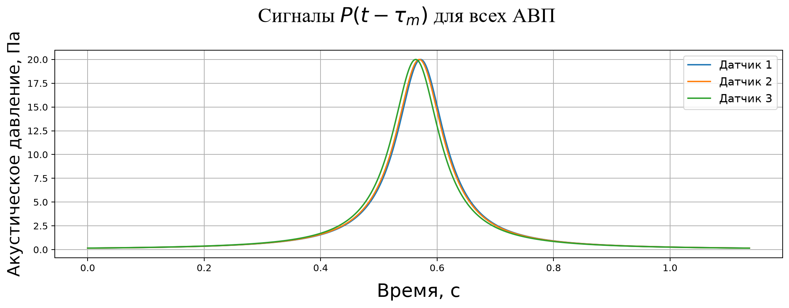
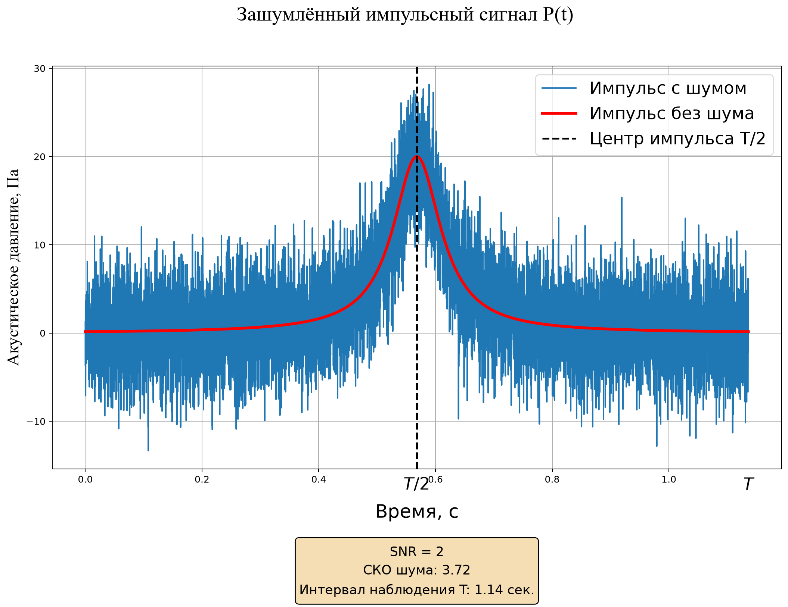
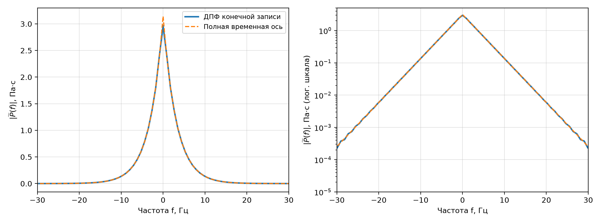
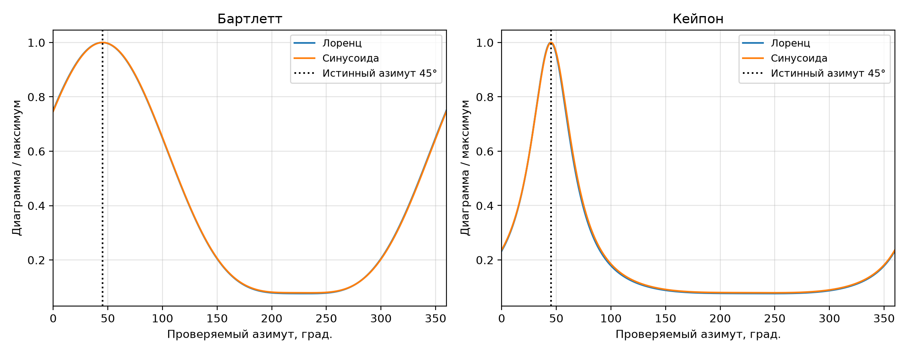
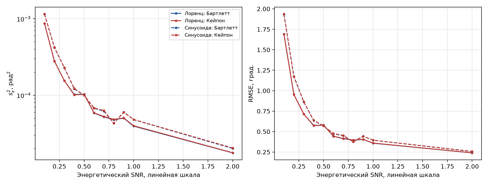

# ИССЛЕДОВАНИЕ ИМПУЛЬСА ЛОРЕНЦА ПРИ ОЦЕНИВАНИИ АЗИМУТА КРУГОВОЙ РЕШЁТКОЙ АВП

Цель работы — исследовать пеленгование источника, излучающего импульс Лоренца, методами Бартлетта и Кейпона и сопоставить результаты с гармоническим сигналом при одинаковом энергетическом отношении сигнал/шум. Теоретические выражения согласованы с конечным интервалом наблюдения и фактической реализацией расчёта.

Оформление принято по документу info_snr_supplement.docx. Графики и оценки получены из расчётной схемы notebook.ipynb и report.ipynb с использованием исходных функций проекта. В отличие от числового примера дополнения, где τ = 0,01 с, здесь использовано текущее значение duration_pulse = 0,05 с. Значения из прежнего отчёта для синусоиды не переносились: сравнение выполнено заново с текущим определением SNR.

## Исходные параметры исследования

| Параметр | Значение |
| --- | --- |
| Число АВП M; радиус R | 3; 1,7163 м |
| Скорость звука c | 343,26 м/с |
| Частота дискретизации fₛ; число отсчётов N | 8800 Гц; 10000 |
| Интервал наблюдения T; центр tс | 1,13625 с; 0,568125 с |
| Ширина импульса τ; коэффициент A | 0,05 с; 1 (параметр формулы) |
| Гармонический сигнал | Aₛ = 1 Па; f₀ = 10 Гц |
| Истинный азимут φ₀ | π/4 рад = 45° |
| Базовый SNR; исследуемые SNR | 2; 0,1…1 с шагом 0,1 и точка 2 |
| Реализации шума K; seed | 100 на сочетание параметров; 10 |
| Угловая сетка | 6283 точки; шаг ≈ 0,00100003 рад |

## 1 Определение SNR и выбор интервала интегрирования

Программа обрабатывает конечную запись, поэтому энергия полезного сигнала и средняя энергия шума должны относиться к одному и тому же окну наблюдения. Временная сетка начинается с нуля; её последний отсчёт определяет правую границу T.

$$
\Delta t=1/f_s,\quad t_n=n\Delta t,\quad n=0,\ldots,N-1 \qquad (1)
$$

$$
T=(N-1)/f_s=1.13625\ \mathrm{s} \qquad (2)
$$

Интегрирование от 0 до T следует из границ доступной записи, а не из предположения, что импульс вне окна равен нулю. Импульс Лоренца имеет бесконечные хвосты. Интеграл по всей временной оси характеризует полную энергию его математической формы, но не энергию реально обработанного фрагмента.

$$
E_s(T)=\int_0^T P^2(t)\,dt \qquad (3)
$$

$$
\mathrm{SNR}_T=\frac{E_s(T)}{\mathbb{E}[E_n(T)]}=\frac{E_s(T)}{T\sigma^2} \qquad (4)
$$

Шум в реализации — независимые гауссовские отсчёты с нулевым средним и дисперсией σ². Здесь не используется идеальный непрерывный белый шум с неограниченной полосой и бесконечной точечной дисперсией. Энергия конкретной шумовой реализации случайна; заданный SNR определяется через математическое ожидание шумовой энергии.

$$
\sigma^2=\frac{E_s(T)}{T\,\mathrm{SNR}_T},\qquad \sigma=\sqrt{\frac{E_s(T)}{T\,\mathrm{SNR}_T}} \qquad (5)
$$

Именно последнее выражение реализовано в calculate_noise_level. Энергия в calculate_energy рассчитывается методом трапеций:

$$
E_s^{(d)}=\Delta t\left[\frac{p_0^2}{2}+\sum_{n=1}^{N-2}p_n^2+\frac{p_{N-1}^2}{2}\right] \qquad (6)
$$

$$
\mathbb{E}[E_n^{(d)}]=\Delta t\,(N-1)\sigma^2=T\sigma^2 \qquad (7)
$$

Последнее равенство точно для принятой дискретной модели, поскольку сумма весов трапеций равна N − 1. Деление энергий на одинаковое T даёт эквивалентное отношение средних мощностей. Пиковое отношение и выражение A²/σ² не совпадают с этим SNR. Логарифмическая запись имеет вид SNRдБ = 10 log₁₀(SNR); базовое значение 2 соответствует 3,0103 дБ.

Шумовая дисперсия каждого АВП определяется по энергии его канала давления. В векторных каналах полезные сигналы дополнительно умножаются на cos φ₀ и sin φ₀. Поэтому их энергетические SNR равны SNR·cos²φ₀ и SNR·sin²φ₀; при φ₀ = 45° они составляют половину SNR канала давления.

## 2 Формула импульса с учётом положения центра

$$
P(t)=\frac{A\tau}{\tau^2+(t-t_c)^2},\qquad \tau>0 \qquad (8)
$$

$$
P(t_c)=\frac{A}{\tau},\qquad P(t_c\pm\tau)=\frac{A}{2\tau} \qquad (9)
$$

Параметр τ задаёт половину полной ширины на половине максимума; FWHM = 2τ = 0,1 с. Он не является конечной длительностью импульса. В данной формуле A — коэффициент масштаба, а не высота пика: при A = 1 и τ = 0,05 с максимум равен 20 Па. Если P измеряется в Па, размерность коэффициента A здесь Па·с. В формуле синусоиды аналогичный числовой параметр задаёт амплитуду в Па; для строгого различения ниже он обозначен Aₛ.

Для круговой решётки углы расположения АВП и задержки имеют вид:

$$
\gamma_m=\frac{2\pi(m-1)}{M},\qquad d_m=\frac{R}{c}\cos(\varphi_0-\gamma_m) \qquad (10)
$$

$$
P_m(t)=P(t-d_m)=\frac{A\tau}{\tau^2+(t-t_c-d_m)^2} \qquad (11)
$$

Обозначение dₘ отделяет задержку распространения от параметра ширины τ. В коде dₘ называется tau_array. Центр импульса в канале m находится в tс + dₘ. Для трёх АВП задержки составляют 3,535534; 1,294095; −4,829629 мс соответственно.

## 3 Временная форма и обоснование центра T/2

Опорный импульс помещён в середину окна: tс = T/2 = 0,568125 с. Это обеспечивает равный запас до обеих границ и максимальную долю зарегистрированной энергии для фиксированных T и τ.

![Рисунок 1 — Опорный импульс Лоренца на интервале [0; T]](figures/01_pulse.png)

Утверждение о максимуме можно доказать непосредственно. Обозначим квадрат центрированного импульса через g; g чётна и строго убывает с увеличением положительного аргумента.

$$
g(x)=\frac{A^2\tau^2}{(\tau^2+x^2)^2} \qquad (12)
$$

$$
\frac{d E_s(T;t_c)}{dt_c}=g(t_c)-g(T-t_c) \qquad (13)
$$

При tс < T/2 расстояние до левой границы меньше расстояния до правой, поэтому производная положительна; при tс > T/2 она отрицательна. Следовательно, единственный максимум достигается при tс = T/2. Выбор центра в нуле оставил бы в окне только правую часть формы и существенно уменьшил зарегистрированную энергию. Этот вывод относится к опорному импульсу; центры отдельных каналов дополнительно сдвигаются задержками.

Для произвольного положения центра удобно использовать первообразную квадрата импульса:

$$
H(x)=\frac{A^2}{2}\left[\frac{x}{x^2+\tau^2}+\frac{1}{\tau}\arctan\frac{x}{\tau}\right] \qquad (14)
$$

$$
E_s(T;t_c)=H(T-t_c)-H(-t_c),\qquad E_\infty=\frac{\pi A^2}{2\tau} \qquad (15)
$$

$$
\nu(T)=\frac{2}{\pi}\left[\arctan\frac{T}{2\tau}+\frac{\tau T/2}{(T/2)^2+\tau^2}\right] \qquad (16)
$$

При заданных параметрах E∞ = 31,415927 Па²·с, Eₛ(T) = 31,406921 Па²·с, ν = 0,999713354. В окне содержится 99,971335 % полной энергии. Относительное расхождение аналитической и численной энергий равно 1.131e-11. Численно рассчитанная оконная энергия уже учитывает хвосты за границами; повторное умножение на ν недопустимо.

$$
E_{s,m}=H(T-t_c-d_m)-H(-t_c-d_m) \qquad (17)
$$

В программе этот же результат получается интегрированием P²(u) по сдвинутому вектору u = t − dₘ, то есть на [−dₘ; T − dₘ]. Для текущих задержек энергии трёх каналов давления равны 31,40691924; 31,40692102; 31,40691745 Па²·с. Различие мало благодаря расположению импульса вдали от границ.

При базовом SNR = 2 среднеквадратический уровень шума для опорного импульса составляет σ = 3,717584 Па. На рисунке ниже использован отдельный демонстрационный seed = 42, сохранённый из исходной ячейки notebook.ipynb. Статистические эксперименты далее используют seed = 10.

## 4 Частотный спектр импульса

Чтобы исключить неоднозначность коэффициентов нормировки, определим прямое преобразование Фурье с частотой f в герцах:

$$
\widetilde P(f)=\int_{-\infty}^{\infty}P(t)e^{-i2\pi ft}\,dt \qquad (18)
$$

После замены x = t − tс используется интеграл от τ/(τ² + x²): при замыкании контура в соответствующей полуплоскости его полюсы x = ±iτ дают множитель π exp(−2πτ|f|). Поэтому для полной временной оси получаем:

$$
\widetilde P_\infty(f)=\pi A e^{-2\pi\tau|f|}e^{-i2\pi ft_c} \qquad (19)
$$

$$
|\widetilde P_\infty(f)|=\pi |A|e^{-2\pi\tau|f|} \qquad (20)
$$

Сдвиг центра меняет фазу на −2πftс, но сохраняет модуль спектра полной формы. Модуль максимален при f = 0 и экспоненциально убывает с ростом |f|; широкой полосе соответствует меньшая τ. Энергетическая спектральная плотность равна |P̃∞(f)|², тогда как исходный ноутбук строит модуль |P̃(f)|. Это разные величины.

$$
\int_{-\infty}^{\infty}|\widetilde P_\infty(f)|^2df=\frac{\pi A^2}{2\tau}=E_\infty \qquad (21)
$$

Равенство Парсеваля подтверждает согласованность спектральной нормировки и полной энергии. Однако программа наблюдает только прямоугольное окно [0; T]. Умножение на окно во времени соответствует свёртке спектров в частотной области:

$$
\widetilde P_T(f)=\widetilde P_\infty(f)*W_T(f) \qquad (22)
$$

$$
W_T(f)=T e^{-i\pi fT}\operatorname{sinc}(fT),\quad \operatorname{sinc}(x)=\frac{\sin(\pi x)}{\pi x} \qquad (23)
$$

Функция calculate_freq_spectr выполняет FFT, делит результат на fₛ и применяет fftshift с последующим взятием модуля. Деление на fₛ эквивалентно множителю Δt и приближает интегральное преобразование, поэтому единица вертикальной оси — Па·с. Шаг частот ДПФ равен fₛ/N = 0,88 Гц, а не 1/T; длительность T здесь определяется крайними отсчётами, тогда как период записи ДПФ равен N/fₛ.

$$
\widetilde P_k^{(d)}=\Delta t\sum_{n=0}^{N-1}p_n e^{-i2\pi kn/N} \qquad (24)
$$

В нуле аналитический спектр полной формы равен πA = 3,141593 Па·с. Для конечного окна интеграл P(t) равен 2A arctan[T/(2τ)] = 2,966027 Па·с; ДПФ даёт 2,966045 Па·с. Их небольшое различие обусловлено прямоугольными весами ДПФ вместо трапеций. Отклонение от πA существенно больше, поскольку площадь хвостов P(t) убывает медленнее, чем энергия хвостов P²(t). Поэтому близость ν к единице не означает точного совпадения модулей спектров во всех частотных точках.

Для низкочастотного приближения важно учитывать отсутствие строгой верхней границы спектра импульса. Вместо неё можно ввести симметричную полосу, содержащую 99 % энергии полной формы:

$$
\frac{\int_{-F}^{F}|\widetilde P_\infty(f)|^2df}{E_\infty}=1-e^{-4\pi\tau F} \qquad (25)
$$

Отсюда F₉₉ = ln(100)/(4πτ) = 7,329356 Гц. Для этой границы c/(2RF₉₉) = 13,644, то есть превышает 10. Это энергетическое обоснование принятого приближения; спектральный хвост за F₉₉ при этом сохраняется. Для синусоиды f₀ = 10 Гц параметр c/(2Rf₀) точно равен 10.

## 5 Оценивание азимута и сравнение с синусоидой

Каналы АВП формируются по модели y₀⁽ᵐ⁾ = Pₘ + e₀⁽ᵐ⁾, y₁⁽ᵐ⁾ = Pₘ cos φ₀ + e₁⁽ᵐ⁾, y₂⁽ᵐ⁾ = Pₘ sin φ₀ + e₂⁽ᵐ⁾. Шумы независимы между датчиками, каналами и реализациями. Матрица X содержит 3M строк каналов и N столбцов отсчётов.

$$
W=\frac{XX^{\mathsf T}}{N},\qquad a(\varphi)=[1,\cos\varphi,\sin\varphi,\ldots]^{\mathsf T} \qquad (26)
$$

Матрица W в исходном коде является матрицей вторых моментов без вычитания временного среднего. Для импульса с ненулевым средним это существенно: замена на центрированную ковариацию изменила бы постановку эксперимента. В направляющем векторе задержки не учитываются — применяется низкочастотное приближение исходной модели.

$$
B(\varphi)=a^{\mathsf T}(\varphi)Wa(\varphi) \qquad (27)
$$

$$
C(\varphi)=\frac{1}{a^{\mathsf T}(\varphi)W^{-1}a(\varphi)} \qquad (28)
$$

$$
\widehat\varphi=\underset{\varphi\in\Phi}{\operatorname{argmax}}\,B(\varphi)\quad\text{или}\quad\underset{\varphi\in\Phi}{\operatorname{argmax}}\,C(\varphi) \qquad (29)
$$

В реализации используются обычная обратная матрица для Кейпона и дискретный поиск максимума. Диагональная нагрузка и интерполяция максимума не добавлялись. Половина шага угловой сетки составляет около 0,02865°; это масштаб квантования, но не гарантированная граница полной ошибки при наличии шума. Метод MUSIC не включён, поскольку в текущих расчётных функциях и ноутбуках он не реализован.

Сигнал сравнения имеет вид Pₛ(t) = Aₛ sin(2πf₀t). Для обоих сигналов оставлены одинаковые окно, решётка, угловая сетка и целевой энергетический SNR; шум масштабируется отдельно по фактической энергии каждого сигнала. Это сравнение при равном SNR, а не при одинаковой пиковой амплитуде, одинаковой энергии или одной общей абсолютной дисперсии шума.

| Величина | Импульс Лоренца | Синусоида |
| --- | --- | --- |
| Энергия в окне, Па²·с | 31,406921 | 0,572055 |
| Максимальная амплитуда, Па | 20 | 1 |
| СКО шума при SNR = 2, Па | 3,717584 | 0,501726 |
| Центр / частота | tс = 0,568125 с | f₀ = 10 Гц |

## 5.1 Оценки для одной реализации

В этой проверке для каждого типа сигнала заново создаётся генератор с seed = 10. Оба метода обрабатывают одну матрицу наблюдений данного сигнала. Стандартизованные шумы между типами сигналов одинаковы, но их абсолютный масштаб различается вследствие энергетической нормировки.

| Сигнал | Метод | Оценка, град. | Ошибка, град. |
| --- | --- | --- | --- |
| Лоренц | Бартлетт | 44,921216 | -0,078784 |
| Лоренц | Кейпон | 44,921216 | -0,078784 |
| Синусоида | Бартлетт | 45,207703 | 0,207703 |
| Синусоида | Кейпон | 45,207703 | 0,207703 |

Диаграммы разделены на собственные максимумы; это сохраняет положения оценок. Более узкий максимум Кейпона сам по себе не доказывает меньшую дисперсию ошибки. Совпадение оценок двух методов в этой реализации означает совпадение выбранного узла сетки, а не тождественность алгоритмов. Одной реализации недостаточно для вывода о сравнительной точности.

## 5.2 Статистический эксперимент

Для каждого типа сигнала, метода и значения SNR выполнено K = 100 реализаций. В каждой паре «сигнал — метод» генератор независимо инициализируется seed = 10 и последовательно расходуется по SNR в возрастающем порядке. Таким образом, сравниваемые методы используют одинаковые шумовые последовательности; объекты конфигурации и генераторы не разделяются между методами. Это устраняет зависимость сравнения от порядка вызова restart_rng в исходном report.ipynb.

Ошибка приводится к главному круговому интервалу, после чего рассчитываются средняя ошибка, несмещённая выборочная дисперсия и корень средней квадратичной ошибки:

$$
\varepsilon_k=((\widehat\varphi_k-\varphi_0+\pi)\bmod 2\pi)-\pi \qquad (30)
$$

$$
\overline\varepsilon=\frac1K\sum_{k=1}^{K}\varepsilon_k,\qquad s_\varepsilon^2=\frac{\sum_{k=1}^{K}(\varepsilon_k-\overline\varepsilon)^2}{K-1} \qquad (31)
$$

$$
\mathrm{RMSE}=\sqrt{\frac1K\sum_{k=1}^{K}\varepsilon_k^2} \qquad (32)
$$

Различие дисперсии и средней квадратичной ошибки учитывается явно: RMSE² = [(K − 1)/K]s² + ε̄². Для наблюдаемых ошибок вблизи нуля обычные выборочные моменты круговой ошибки содержательно интерпретируемы; результаты не относятся к режиму ошибок, распределённых по всей окружности.

Ниже приведены опорные точки; полная таблица по всем 11 значениям SNR сохранена в statistics.csv. Дисперсия указана в радианах в квадрате, RMSE — в градусах.

| SNR | Сигнал | Метод | s², рад² | RMSE, град. |
| --- | --- | --- | --- | --- |
| 0,1 | Лоренц | Бартлетт | 8.6719e-04 | 1,6896 |
| 0,1 | Лоренц | Кейпон | 8.6697e-04 | 1,6892 |
| 0,1 | Синусоида | Бартлетт | 1.1461e-03 | 1,9317 |
| 0,1 | Синусоида | Кейпон | 1.1517e-03 | 1,9366 |
| 0,5 | Лоренц | Бартлетт | 1.0327e-04 | 0,5796 |
| 0,5 | Лоренц | Кейпон | 1.0270e-04 | 0,5780 |
| 0,5 | Синусоида | Бартлетт | 9.9804e-05 | 0,5705 |
| 0,5 | Синусоида | Кейпон | 9.9738e-05 | 0,5702 |
| 1,0 | Лоренц | Бартлетт | 3.9413e-05 | 0,3584 |
| 1,0 | Лоренц | Кейпон | 3.9891e-05 | 0,3604 |
| 1,0 | Синусоида | Бартлетт | 4.7907e-05 | 0,3949 |
| 1,0 | Синусоида | Кейпон | 4.8097e-05 | 0,3956 |
| 2,0 | Лоренц | Бартлетт | 1.7622e-05 | 0,2400 |
| 2,0 | Лоренц | Кейпон | 1.7704e-05 | 0,2403 |
| 2,0 | Синусоида | Бартлетт | 2.0128e-05 | 0,2558 |
| 2,0 | Синусоида | Кейпон | 2.0425e-05 | 0,2577 |

При увеличении SNR общий уровень ошибки снижается, однако отдельные точки не обязаны быть монотонными из-за конечного числа реализаций. В показанной выборке оценки Бартлетта и Кейпона имеют близкую точность. При SNR = 2 RMSE импульса составляет 0,2400° и 0,2403°, а синусоиды — 0,2558° и 0,2577° соответственно. При SNR = 0,5 импульс в этой выборке немного уступает синусоиде; универсального преимущества формы сигнала результаты не устанавливают.

Чтобы оценить неопределённость сравнения в базовой точке SNR = 2, рассчитаны парные процентильные bootstrap-интервалы для отношения дисперсий «импульс / синусоида»: 20000 повторных выборок индексов реализаций с возвращением, отдельный seed = 20261023. Один и тот же набор индексов используется для обоих сигналов, поскольку стандартизованные шумы сопоставлены попарно. Интервалы приближённые и относятся к данной точке, без поправки на множественные сравнения по всей сетке SNR.

| Метод | Отношение s² | Приближённый 95 % интервал |
| --- | --- | --- |
| Бартлетт | 0,876 | [0,563; 1,352] |
| Кейпон | 0,867 | [0,562; 1,326] |

Оба интервала включают единицу. Поэтому небольшое наблюдаемое различие при SNR = 2 не является достаточным основанием утверждать превосходство импульса над синусоидой по дисперсии. Неопределённость конечной выборки следует отличать от точности вычисления отдельных оценок на заданной угловой сетке.

## 6 Выводы

1. Для импульсного сигнала SNR согласован с наблюдаемым окном [0; T] и определяется как Eₛ(T)/(Tσ²). Конечные пределы следуют из доступной записи. Принятый расчёт трапециями обеспечивает точное равенство средней дискретной энергии шума Tσ².

2. Положение tс = T/2 максимизирует зарегистрированную энергию опорного импульса и симметрично располагает его хвосты относительно границ окна. При τ = 0,05 с в запись попадает 99,971335 % полной энергии. Пики канальных сигналов находятся в T/2 + dₘ.

3. При выбранной нормировке преобразования Фурье модуль спектра полной формы равен π|A|exp(−2πτ|f|). Спектр конечной записи отличается из-за прямоугольного окна; доля энергии ν не определяет относительную ошибку модуля спектра в каждой частотной точке.

4. В исследованной конфигурации оба метода восстанавливают азимут вблизи 45°. Для 100 реализаций при SNR = 2 RMSE находится около 0,24° у импульса и 0,26° у синусоиды. Парные bootstrap-интервалы отношения дисперсий включают единицу; устойчивое преимущество одного сигнала или метода по этим данным не установлено.

5. Выводы относятся к текущим ширине импульса, длине записи, решётке, белому гауссовскому шуму и направляющему вектору без задержек. Изменение этих условий требует отдельного исследования. Физическая измерительная калибровка и модель окрашенного шума в данном эксперименте не рассматривались.

## Приложение. Воспроизводимость и сохранность исходного кода

Рабочий ноутбук lorentz_research.ipynb содержит выполненные ячейки, графики и числовые результаты. Ячейки исходного notebook.ipynb перенесены с добавлением сохранения рисунков; исходные функции сигнала, энергии, генерации каналов и оценивания использованы без изменений. Статистическая схема report.ipynb развёрнута через list_errors для сохранения отдельных ошибок и вычисления дополнительных статистик; её дисперсии проверены на совпадение с var_vs_params в двух контрольных точках.

Все исходные ноутбуки, файлы py_files/*.py, tests/*.py и оба исходных документа проверены по SHA-256 до и после расчёта. Контрольные суммы совпали; пользовательские изменения, существовавшие до работы, сохранены. Манифест проверки находится в source_integrity.json. Временного редактирования исходных файлов не потребовалось.

Среда расчёта: Python 3.13.5, NumPy 2.5.4, Matplotlib 3.11.2. Вызов из корня проекта: .env/Scripts/python.exe reports/lorentz_study/run_study.py; затем .env/Scripts/python.exe reports/lorentz_study/build_report.py. Для сборки документа используются python-docx, latex2mathml и таблица преобразования MathML → OMML из установленного Microsoft Office. Формулы в DOCX являются редактируемыми объектами Word.

Комплект результатов: results.json — параметры и сводные числа; statistics.csv — полная таблица статистик; errors.json — индивидуальные ошибки; comparison_intervals.json — интервалы отношения дисперсий; figures/ — исходные рисунки PNG. Время исполнения не используется как результат исследования.
