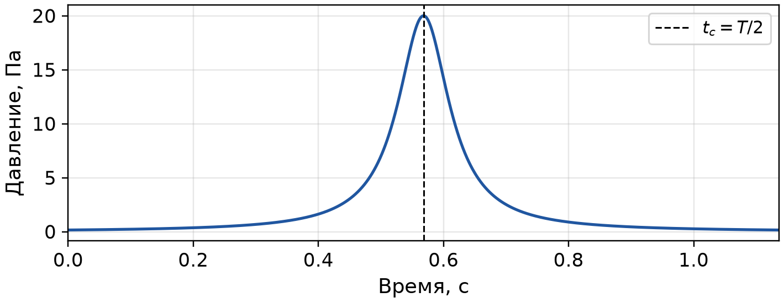
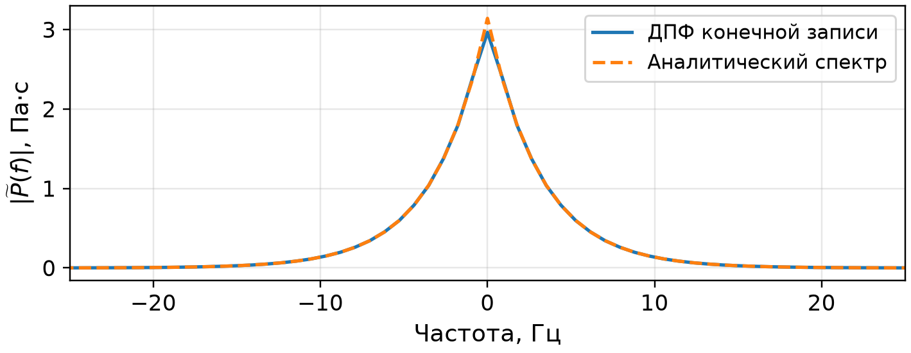
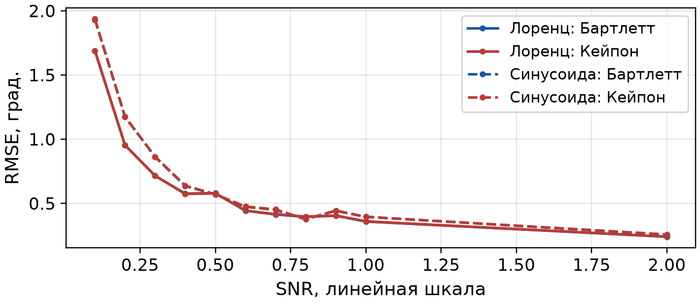

# Исследование импульса Лоренца

Параметры: M = 3 АВП; R = 1,7163 м; c = 343,26 м/с; fₛ = 8800 Гц; N = 10000; τ = 0,05 с; истинный азимут φ₀ = 45°. Синусоида сравнения: амплитуда 1 Па, частота 10 Гц.

## 1 Отношение сигнал/шум

Отношение SNR задаётся через энергию сигнала и математическое ожидание энергии шума на одном интервале наблюдения:

$$
\mathrm{SNR}=\frac{E_s(T)}{\mathbb{E}[E_n(T)]}=\frac{\displaystyle\int_0^T P^2(t)\,dt}{T\sigma^2}
$$

Здесь σ² — дисперсия гауссовских шумовых отсчётов. Для принятого расчёта методом трапеций средняя энергия шума равна Tσ². Длительность записи определяется первым и последним отсчётами:

$$
T=\frac{N-1}{f_s}=1{,}13625\ \mathrm{с}
$$

Интегрируем от 0 до T, поскольку алгоритм обрабатывает только эту запись. Хвосты импульса вне окна в расчёт SNR не входят. Уровень шума задаётся по фактической энергии в окне:

$$
\sigma=\sqrt{\frac{E_s(T)}{T\,\mathrm{SNR}}}
$$

## 2 Импульс и положение его центра

$$
P(t)=\frac{A\tau}{\tau^2+(t-t_c)^2},\qquad t_c=\frac{T}{2}
$$

В расчёте A = 1 Па·с, поэтому высота пика A/τ = 20 Па. Параметр τ — половина ширины на половине максимума; полная ширина равна 0,1 с. Центр tс = 0,568125 с.

Положение T/2 даёт одинаковый запас до границ окна. Для симметричного импульса, убывающего от центра, оно максимизирует энергию в записи. При заданных параметрах в окно попадает 99,9713 % полной энергии. На m-м АВП сигнал P(t − dₘ) имеет центр tс + dₘ, где dₘ — задержка распространения.

## 3 Спектр импульса

Для преобразования Фурье по частоте f в герцах:

$$
\widetilde P(f)=\int_{-\infty}^{\infty}P(t)e^{-i2\pi ft}\,dt
$$

Спектр полной импульсной формы и его модуль равны:

$$
\widetilde P_\infty(f)=\pi A e^{-2\pi\tau|f|}e^{-i2\pi ft_c}
$$

$$
|\widetilde P_\infty(f)|=\pi|A|e^{-2\pi\tau|f|}
$$

Сдвиг центра меняет фазу, сохраняя модуль спектра полной формы. Максимум расположен при f = 0; с ростом |f| спектр экспоненциально убывает.

ДПФ нормирована множителем 1/fₛ. Отличие около нуля вызвано конечным окном: ДПФ даёт 2,9660 Па·с, а полная форма — πA ≈ 3,1416 Па·с.

## 4 Оценка азимута и сравнение с синусоидой

Методы Бартлетта и Кейпона сравнивались при одинаковом энергетическом SNR, одной решётке и одной записи. Для каждого сигнала шум нормировался по его энергии. На каждую точку SNR выполнено 100 реализаций; seed = 10.

Точность характеризуется корнем средней квадратичной ошибки:

$$
\mathrm{RMSE}=\sqrt{\frac{1}{K}\sum_{k=1}^{K}\varepsilon_k^2},\qquad K=100
$$

Здесь εₖ — круговая разность оценки и истинного азимута. В таблице приведены оценка для одной реализации при SNR = 2 и RMSE по 100 реализациям при том же SNR.

| Сигнал | Метод | Оценка, град. | RMSE, град. |
| --- | --- | --- | --- |
| Лоренц | Бартлетт | 44,9212 | 0,2400 |
| Лоренц | Кейпон | 44,9212 | 0,2403 |
| Синусоида | Бартлетт | 45,2077 | 0,2558 |
| Синусоида | Кейпон | 45,2077 | 0,2577 |

С ростом SNR ошибки в целом уменьшаются. При SNR = 2 RMSE составляет около 0,24° для импульса и 0,26° для синусоиды. Точность методов близка. Небольшая разница между сигналами в этой выборке не доказывает устойчивого преимущества импульса.
